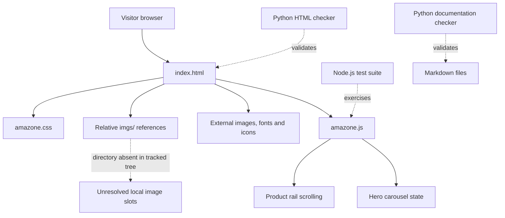
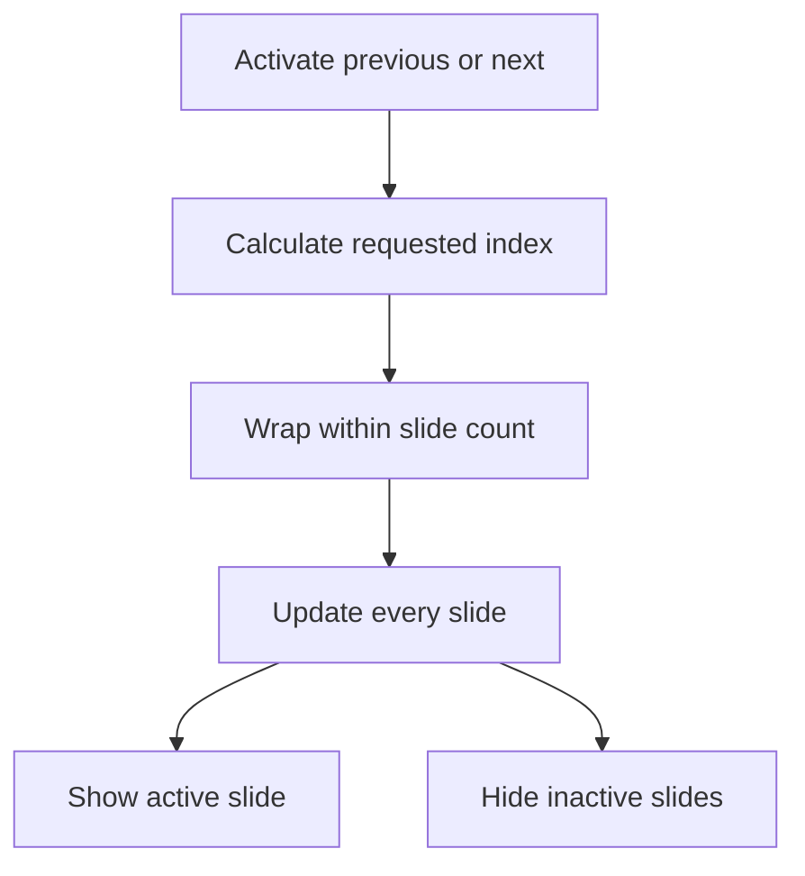
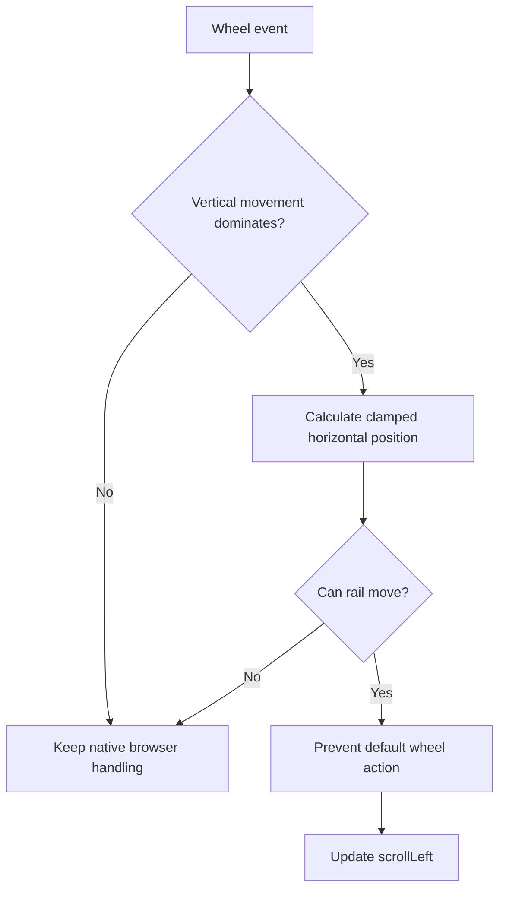

# 🛒 Amazon Clone

[](https://github.com/Brajesh31/Amazon_Clone/actions/workflows/ci.yml)
[](https://github.com/Brajesh31/Amazon_Clone/actions/workflows/docs-check.yml)
[](LICENSE)
[](https://developer.mozilla.org/docs/Web/HTML)
[](https://developer.mozilla.org/docs/Web/CSS)
[](https://developer.mozilla.org/docs/Web/JavaScript)

An **Amazon-inspired static storefront prototype** built with HTML, CSS, and vanilla JavaScript. It demonstrates marketplace-style navigation, a promotional hero carousel, category cards, horizontally scrollable product sections, and deal cards.

> [!IMPORTANT]
> This is an educational frontend prototype, not a functioning online store. It is not affiliated with, sponsored by, or endorsed by Amazon. Search, accounts, cart operations, product detail pages, checkout, payment processing, inventory, and order management are not implemented.

## 📑 Contents

- [✨ Project overview](#-project-overview)
- [🎯 Goals and scope](#-goals-and-scope)
- [🧩 Feature status](#-feature-status)
- [🛠️ Technology](#️-technology)
- [🏗️ Architecture](#️-architecture)
- [🗂️ Repository structure](#️-repository-structure)
- [🚀 Installation and local preview](#-installation-and-local-preview)
- [🧪 Validation and tests](#-validation-and-tests)
- [🧭 Browser workflows](#-browser-workflows)
- [🖼️ Assets and visual resources](#️-assets-and-visual-resources)
- [♿ Accessibility](#-accessibility)
- [🔐 Security and privacy](#-security-and-privacy)
- [⚠️ Known limitations](#️-known-limitations)
- [🤝 Contribution workflow](#-contribution-workflow)
- [📚 Documentation index](#-documentation-index)
- [🗺️ Roadmap](#️-roadmap)
- [📄 License and project identity](#-license-and-project-identity)

## ✨ Project overview

The project brings several common storefront interface patterns into one small browser application. It is intentionally dependency-light: no package installation, bundler, frontend framework, or backend is required.

The page is composed of three primary browser-facing files:

| File | Responsibility | Runtime role |
|---|---|---|
| `index.html` | Navigation, hero area, category cards, product rails, deal cards, footer | Static document and content |
| `amazone.css` | Layout, typography, colours, card presentation, overflow, breakpoints | Visual presentation |
| `amazone.js` | Hero slide selection and wheel-assisted product rail scrolling | Browser interaction |

Supporting files provide automated tests, HTML validation, documentation checks, and GitHub automation.

## 🎯 Goals and scope

### Learning goals

- Practise semantic page structure using HTML5.
- Build responsive layouts with CSS Flexbox, overflow, and media queries.
- Implement small interactions using browser-native JavaScript.
- Understand event handling and horizontal scroll boundaries.
- Keep browser behaviour testable without third-party runtime dependencies.
- Document the difference between a visual storefront and a real commerce system.

### Explicit non-goals

The current source does not implement:
- Product search or filtering.
- User registration, authentication, or account sessions.
- A functional cart or wishlist.
- Product detail pages or working category routes.
- Checkout, payment processing, tax, shipping, or refunds.
- Inventory, order management, or customer service workflows.
- An application API, database, or persistent user data.

A visual control is not a completed feature unless it performs the action a visitor reasonably expects.

## 🧩 Feature status

| Feature | Status | Implementation detail |
|---|---|---|
| Marketplace-style top navigation | Presentation-only | Static labels and layout |
| Secondary navigation | Presentation-only | Static category/deal labels |
| Hero carousel | Implemented | Previous/next buttons, first-slide initialization, wrap-around |
| Category cards | Presentation-only | Static headings, images, placeholder anchors |
| Product rails | Implemented | CSS horizontal overflow |
| Vertical wheel support | Implemented | Translates vertical-dominant wheel movement when the rail can move |
| Responsive layout | Implemented in CSS | Media queries at 900px, 600px, and 380px |
| Search | Not implemented | Search input is visual only |
| Account and orders | Not implemented | Static text only |
| Cart and checkout | Not implemented | No cart state or transaction flow |
| Live price and inventory | Not implemented | Text values are static examples |

See [Feature Reference](docs/features.md) for detailed behaviour and acceptance criteria.

## 🛠️ Technology

| Area | Technology | Why it is used |
|---|---|---|
| Markup | HTML5 | Page structure and native controls |
| Styling | CSS3 | Responsive layout and visual hierarchy |
| Browser interaction | Vanilla JavaScript | Carousel and product rail behaviour |
| Behaviour tests | Node.js built-in test runner | Dependency-free regression tests |
| HTML validation | Python standard library | Structure and local-reference checks |
| Documentation validation | Python standard library | Local Markdown link and file checks |
| Local preview | Python HTTP server | Static development server |
| CI | GitHub Actions | Automated repository checks |

No npm dependencies or application packages are required by the current implementation.

## 🏗️ Architecture



The browser loads a static document, stylesheet, JavaScript file, and referenced visual resources. There is no application server, API, database, authentication service, or persistent data layer.

### Runtime behaviour

1. The browser parses `index.html`.
2. It loads the local stylesheet and external icon stylesheet.
3. It resolves remote and relative local image resources.
4. It loads `amazone.js` at the end of the document body.
5. The script queries the carousel slides, controls, and product rails.
6. It selects the first hero slide and attaches the supported event handlers.
7. The browser renders the page and responds to carousel and rail interactions.

See [Architecture](docs/architecture.md), [System Design](docs/system-design.md), and [Workflow](docs/workflow.md).

## 🗂️ Repository structure

```text
Amazon_Clone/
├── .github/
│   ├── ISSUE_TEMPLATE/
│   │   ├── bug_report.yml
│   │   ├── documentation.yml
│   │   └── feature_request.yml
│   ├── workflows/
│   │   ├── ci.yml
│   │   ├── docs-check.yml
│   │   └── update-readme.yml
│   ├── PULL_REQUEST_TEMPLATE.md
│   └── dependabot.yml
├── docs/
│   ├── adr/
│   ├── ACCESSIBILITY.md
│   ├── ASSET-INVENTORY.md
│   ├── QA.md
│   ├── SECURITY-REVIEW.md
│   ├── README.md
│   ├── accessibility-test-plan.md
│   ├── api.md
│   ├── architecture.md
│   ├── data-flow.md
│   ├── database.md
│   ├── deployment.md
│   ├── development.md
│   ├── documentation-maintenance.md
│   ├── faq.md
│   ├── features.md
│   ├── future-scope.md
│   ├── glossary.md
│   ├── installation.md
│   ├── limitations.md
│   ├── maintenance.md
│   ├── observability.md
│   ├── project-overview.md
│   ├── project-structure.md
│   ├── system-design.md
│   ├── testing-strategy.md
│   ├── troubleshooting.md
│   └── workflow.md
├── scripts/
│   ├── check_docs.py
│   └── check_html.py
├── tests/
│   └── amazone.test.js
├── .editorconfig
├── .env.example
├── .gitignore
├── CHANGELOG.md
├── CITATION.cff
├── CODEOWNERS
├── CODE_OF_CONDUCT.md
├── CONTRIBUTING.md
├── LICENSE
├── README.md
├── RELEASE-CHECKLIST.md
├── ROADMAP.md
├── SECURITY.md
├── SUPPORT.md
├── amazone.css
├── amazone.js
└── index.html
```

The tree is intended to reflect the tracked project layout. See [Project Structure](docs/project-structure.md) for the responsibility of each file and directory.

## 🚀 Installation and local preview

### Prerequisites

- A modern browser with JavaScript enabled.
- Python 3 for the static HTTP server and HTML checker.
- Node.js 20 or newer for the built-in test runner.
- Git to clone the repository.

### Clone the project

```bash
git clone https://github.com/Brajesh31/Amazon_Clone.git
cd Amazon_Clone
```

### Start the local server

Run this command from the repository root:

```bash
python -m http.server 8000
```

Open <http://localhost:8000/>.

Serving from the root matters because the document uses relative paths such as `./amazone.css`, `./amazone.js`, and `imgs/...`. Opening the HTML directly with a `file://` URL is not an equivalent deployment test.

### Stop the server

Use Ctrl+C in the terminal running the Python server.

See [Installation](docs/installation.md) for additional setup details and troubleshooting.

## 🧪 Validation and tests

Run the complete local validation set from the repository root:

```bash
node --check amazone.js
node --test tests/*.test.js
python scripts/check_html.py
python scripts/check_docs.py
```

### What each command checks

| Command | Validation |
|---|---|
| `node --check amazone.js` | JavaScript syntax |
| `node --test tests/*.test.js` | Carousel and product rail behaviour using a mock DOM |
| `python scripts/check_html.py` | Required entry files, document metadata, duplicate IDs, image alt attributes, and local references |
| `python scripts/check_docs.py` | Non-empty Markdown files, documentation entry points, and repository-relative Markdown links |

### Testing limitations

The Node.js tests do not run a real browser rendering engine. They do not prove CSS layout, remote resource availability, screen-reader output, or physical input-device behaviour. Manual browser and accessibility testing remains necessary.

The HTML checker reports missing local image paths as warnings. The documentation checker validates local file targets but does not validate remote URLs or Markdown heading fragments.

## 🧭 Browser workflows

### Carousel



### Product rail



The rail handler deliberately allows normal page scrolling when the rail reaches a boundary. See [Workflow](docs/workflow.md) and [Data Flow](docs/data-flow.md).

## 🖼️ Assets and visual resources

The current HTML contains **47 references across 31 unique local image paths** under `imgs/`, but the tracked repository does not contain that directory. Product and category image slots are therefore unresolved in a clean checkout.

The page also references remote hero images, logo/icon images, Font Awesome, and Google Fonts. These resources may become unavailable or change independently of the repository.

### Asset policy

- Use original or permissively licensed assets.
- Record the source, creator, licence or permission, and required attribution.
- Do not assume a public URL grants redistribution rights.
- Do not download retailer imagery merely because its filename appears in the source.
- Review alternative text against the actual image.
- Update the [Asset Inventory](docs/ASSET-INVENTORY.md) whenever an asset changes.

No fabricated screenshots are included. Add screenshots only after capturing the actual running project.

## ♿ Accessibility

Accessibility is an ongoing review requirement, not a badge or a claim of certification.

The current implementation includes native carousel buttons, accessible labels for those buttons, a labelled demonstration search input, and `aria-hidden` updates on carousel slides. Remaining review areas include image alternatives, placeholder controls, keyboard flow, contrast, zoom/reflow, and assistive technology behaviour.

Read:
- [Accessibility Notes](docs/ACCESSIBILITY.md)
- [Accessibility Test Plan](docs/accessibility-test-plan.md)

## 🔐 Security and privacy

The current page does not process credentials, payments, or personal account records. It has no backend or database. This does not remove the need to review external resource hosts, safe future DOM updates, workflow permissions, and asset rights.

Never commit secrets or expose privileged credentials in browser code. Any future commerce backend needs a separate threat model and server-side controls.

Read:
- [Security Policy](SECURITY.md)
- [Security Review](docs/SECURITY-REVIEW.md)

## ⚠️ Known limitations

- The project is a visual prototype, not an e-commerce platform.
- Search, account, cart, orders, product details, checkout, and payments are not implemented.
- Product and promotion content is hard-coded in HTML.
- There is no API, database, authentication, inventory, or persistence.
- The local `imgs/` directory is missing from the tracked repository.
- External visual resources depend on third-party hosts.
- Automated JavaScript tests use a mock DOM rather than a real browser.
- No browser end-to-end or screenshot-based visual regression suite is configured.

See [Limitations](docs/limitations.md) and [Troubleshooting](docs/troubleshooting.md).

## 🤝 Contribution workflow

Contributions should be focused, tested, accessible, and documented.

1. Read [CONTRIBUTING.md](CONTRIBUTING.md).
2. Review the architecture and feature status.
3. Reproduce the problem or define an observable user outcome.
4. Make a focused change and preserve existing useful files.
5. Add or update tests for changed behaviour.
6. Run all four validation commands.
7. Test the page in a browser at narrow and wide viewports.
8. Update related documentation, diagrams, asset records, and changelog.
9. Complete the pull request template with checks actually performed.

Use the GitHub issue forms for bug reports, feature proposals, and documentation improvements. Security concerns must follow [SECURITY.md](SECURITY.md), not a public issue.

## 📚 Documentation index

Start with the [Documentation Hub](docs/README.md).

| Document | Purpose |
|---|---|
| [Project Overview](docs/project-overview.md) | Goals, audience, scope, and non-goals |
| [Project Structure](docs/project-structure.md) | Repository tree and file responsibilities |
| [Architecture](docs/architecture.md) | Runtime components and dependencies |
| [System Design](docs/system-design.md) | Current design constraints and decision gates |
| [Workflow](docs/workflow.md) | Startup, carousel, and product rail diagrams |
| [Features](docs/features.md) | Implemented and presentation-only behaviour |
| [Data Flow](docs/data-flow.md) | Static content and browser state |
| [Installation](docs/installation.md) | Local setup |
| [Development](docs/development.md) | Source editing and validation |
| [Testing Strategy](docs/testing-strategy.md) | Automated and manual test coverage |
| [Quality Assurance](docs/QA.md) | Quality gates and browser checks |
| [Deployment](docs/deployment.md) | Static hosting and rollback |
| [Maintenance](docs/maintenance.md) | Routine operations and incident handling |
| [Observability](docs/observability.md) | Diagnostics and monitoring boundaries |
| [API Status](docs/api.md) | Current integration status and future API requirements |
| [Database Status](docs/database.md) | Current persistence status |
| [Asset Inventory](docs/ASSET-INVENTORY.md) | Missing local images and rights register |
| [Accessibility](docs/ACCESSIBILITY.md) | Semantic and assistive technology considerations |
| [Accessibility Test Plan](docs/accessibility-test-plan.md) | Keyboard, screen-reader, and visual checks |
| [Security Review](docs/SECURITY-REVIEW.md) | Current security boundaries and future requirements |
| [Limitations](docs/limitations.md) | Known constraints and claims to avoid |
| [Future Scope](docs/future-scope.md) | Proposed engineering opportunities |
| [Troubleshooting](docs/troubleshooting.md) | Common setup and runtime problems |
| [FAQ](docs/faq.md) | Frequently asked questions |
| [Glossary](docs/glossary.md) | Project terminology |
| [Documentation Maintenance](docs/documentation-maintenance.md) | Documentation quality standard |
| [ADR 0001](docs/adr/0001-static-frontend-prototype.md) | Decision to retain the static architecture |

## 🗺️ Roadmap

See [ROADMAP.md](ROADMAP.md) for phased improvements. Future items are proposals, not completed features or delivery commitments. The immediate priority is to resolve missing assets and complete browser/accessibility review before expanding the feature set.

## 📄 License and project identity

The repository software is distributed under the MIT License. See [LICENSE](LICENSE).

This is an independent educational interface prototype. Amazon names, logos, product images, and other third-party materials remain subject to their respective rights and permissions. The repository's software licence does not grant rights to unrelated third-party assets.

---

**Maintainer:** Brajesh Kumar  
**Repository:** [Brajesh31/Amazon_Clone](https://github.com/Brajesh31/Amazon_Clone)  
**Project type:** Static frontend learning prototype
