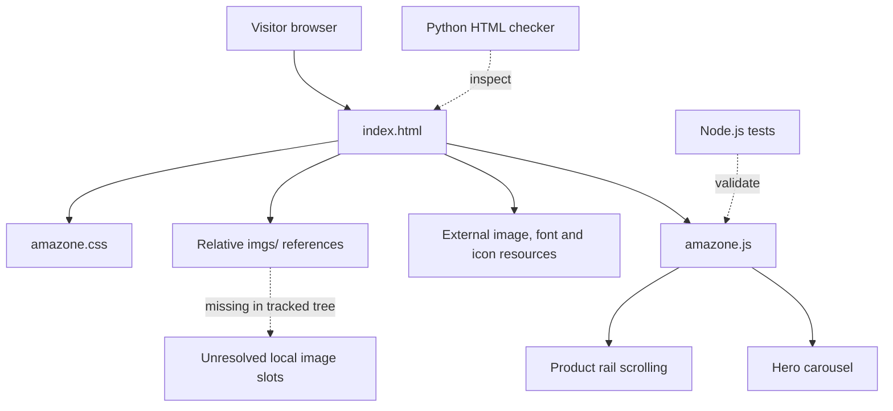
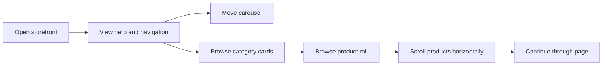

# 🛒 Amazon Clone

[](https://github.com/Brajesh31/Amazon_Clone/actions/workflows/ci.yml)
[](LICENSE)
[](https://developer.mozilla.org/docs/Web/HTML)
[](https://developer.mozilla.org/docs/Web/CSS)
[](https://developer.mozilla.org/docs/Web/JavaScript)

An **Amazon-inspired static storefront prototype** built with HTML, CSS, and vanilla JavaScript. The page demonstrates marketplace-style navigation, a promotional hero carousel, category cards, horizontally scrollable product sections, and deal cards.

> [!IMPORTANT]
> This is an educational frontend prototype, not a functioning online store. It is not affiliated with or endorsed by Amazon. Search, accounts, cart operations, product detail pages, checkout, payment processing, inventory, and order management are not implemented.

## 📑 Contents

- [✨ Overview](#-overview)
- [🎯 Objectives](#-objectives)
- [🧩 Features](#-features)
- [🛠️ Technology](#️-technology)
- [🏗️ Architecture](#️-architecture)
- [🗂️ Project structure](#️-project-structure)
- [🚀 Run locally](#-run-locally)
- [🧪 Automated checks](#-automated-checks)
- [🧭 User workflow](#-user-workflow)
- [🖼️ Assets and screenshots](#️-assets-and-screenshots)
- [⚠️ Current limitations](#️-current-limitations)
- [🔐 Security and accessibility](#-security-and-accessibility)
- [🤝 Contributing](#-contributing)
- [📚 Documentation](#-documentation)
- [🗺️ Roadmap](#️-roadmap)
- [📄 License](#-license)

## ✨ Overview

The project brings several common storefront interface patterns into one small browser application. It is intentionally dependency-light: no package installation, bundler, frontend framework, or backend is required.

The source is split into three browser-facing files:

| File | Responsibility |
|---|---|
| `index.html` | Page structure, static content, category cards, product cards, and carousel controls |
| `amazone.css` | Layout, styling, responsive breakpoints, and product rail presentation |
| `amazone.js` | Hero slide selection and wheel-assisted product rail scrolling |

## 🎯 Objectives

- Practise semantic page structure with HTML5.
- Build a responsive storefront layout with CSS.
- Implement small interactions using browser-native JavaScript.
- Understand horizontal overflow and wheel-event handling.
- Keep behaviour testable without third-party runtime dependencies.

## 🧩 Features

| Feature | Implementation status | Notes |
|---|---|---|
| Two-level navigation presentation | Static UI | Navigation destinations are not fully implemented |
| Hero image carousel | Implemented | Previous/next controls and wrap-around |
| Category cards | Static UI | Placeholder links |
| Product rails | Implemented | Native horizontal scrolling |
| Vertical-wheel rail support | Implemented | Keeps page scrolling available at rail boundaries |
| Responsive layout | Implemented in CSS | Manual viewport review remains important |
| Search | Not implemented | Visual input only |
| Account and orders | Not implemented | Static labels |
| Cart and checkout | Not implemented | No cart state or transaction flow |

## 🛠️ Technology

| Area | Technology |
|---|---|
| Markup | HTML5 |
| Styling | CSS3 |
| Browser interaction | Vanilla JavaScript |
| Behaviour tests | Node.js built-in test runner |
| HTML validation | Python standard library |
| Local preview | Python static HTTP server |
| External visual resources | Third-party image, font, and icon URLs |

No npm dependencies are required by the current implementation.

## 🏗️ Architecture



The browser loads a static document, stylesheet, JavaScript file, and referenced visual resources. There is no application server, API, database, or persistent data layer.

## 🗂️ Project structure

```text
Amazon_Clone/
├── .github/
│   ├── ISSUE_TEMPLATE/
│   ├── workflows/
│   ├── PULL_REQUEST_TEMPLATE.md
│   └── dependabot.yml
├── docs/
│   ├── adr/
│   ├── README.md
│   ├── ACCESSIBILITY.md
│   ├── ASSET-INVENTORY.md
│   ├── QA.md
│   ├── SECURITY-REVIEW.md
│   ├── architecture.md
│   ├── data-flow.md
│   ├── features.md
│   ├── project-overview.md
│   ├── project-structure.md
│   ├── workflow.md
│   └── ...
├── scripts/
│   └── check_html.py
├── tests/
│   └── amazone.test.js
├── index.html
├── amazone.css
├── amazone.js
├── README.md
├── CONTRIBUTING.md
├── SECURITY.md
├── ROADMAP.md
└── LICENSE
```

See [Project Structure](docs/project-structure.md) for the file-by-file explanation and complete tree.

## 🚀 Run locally

### Prerequisites

- Python 3 for the local static server.
- A modern browser with JavaScript enabled.
- Node.js 20 or newer for the test commands.
- Git, if cloning the project.

### Clone and start

```bash
git clone https://github.com/Brajesh31/Amazon_Clone.git
cd Amazon_Clone
python -m http.server 8000
```

Open <http://localhost:8000/>.

Run the server from the repository root so relative paths resolve correctly. Opening the file directly through a `file://` URL is not a substitute for the HTTP preview.

## 🧪 Automated checks

Run all checks from the project root:

```bash
node --check amazone.js
node --test tests/*.test.js
python scripts/check_html.py
```

The Node.js tests cover carousel and product-rail behaviour. The Python checker validates the HTML and local references. The checker reports missing local images as warnings; that does not mean the assets have been repaired.

## 🧭 User workflow



This describes browsing the prototype only. The placeholder category/product links do not complete a shopping journey.

## 🖼️ Assets and screenshots

The current HTML contains 47 references across 31 unique local image paths under `imgs/`, but the tracked repository does not contain that directory. Category and product image slots are therefore unresolved in a clean checkout.

The hero and several interface resources are loaded from external hosts and may change or become unavailable. Do not add retailer imagery without checking usage rights.

No fabricated screenshots are included. Once approved assets are restored, capture current browser screenshots and place them in a dedicated screenshots directory, then update the asset inventory.

See [Asset Inventory](docs/ASSET-INVENTORY.md).

## ⚠️ Current limitations

- The project is a visual prototype, not an e-commerce platform.
- Search, account, cart, orders, product pages, checkout, and payments are not implemented.
- Product and promotion content is hard-coded in HTML.
- There is no API, database, authentication, inventory, or persistence.
- Local product/category imagery is missing from the tracked repository.
- Third-party resource uptime and usage rights are outside this repository's control.

See [Limitations](docs/limitations.md) and [Future Scope](docs/future-scope.md).

## 🔐 Security and accessibility

The current page does not process credentials, payments, or personal account records. Security review should still consider external resources, safe future DOM updates, and the risk of misrepresenting placeholder UI as real commerce functionality.

Review:
- [Security policy](SECURITY.md)
- [Security review](docs/SECURITY-REVIEW.md)
- [Accessibility notes](docs/ACCESSIBILITY.md)

## 🤝 Contributing

Contributions should be focused, tested, and documented. Preserve the project's static scope unless a feature requirement justifies a larger architectural change.

1. Read [CONTRIBUTING.md](CONTRIBUTING.md).
2. Reproduce the issue or define expected behaviour.
3. Make a focused change.
4. Run all automated checks.
5. Test in a browser at narrow and wide viewports.
6. Update relevant documentation.

Use the repository issue templates for bug reports and feature proposals.

## 📚 Documentation

Start with the [Documentation Hub](docs/README.md). Main technical guides include:

- [Project overview](docs/project-overview.md)
- [Architecture](docs/architecture.md)
- [System design](docs/system-design.md)
- [Project structure](docs/project-structure.md)
- [Workflow diagrams](docs/workflow.md)
- [Features](docs/features.md)
- [Data flow](docs/data-flow.md)
- [Installation](docs/installation.md)
- [Development](docs/development.md)
- [Testing strategy](docs/testing-strategy.md)
- [QA checklist](docs/QA.md)
- [Deployment](docs/deployment.md)
- [Maintenance](docs/maintenance.md)
- [API status](docs/api.md)
- [Database status](docs/database.md)
- [Accessibility](docs/ACCESSIBILITY.md)
- [Security review](docs/SECURITY-REVIEW.md)
- [Troubleshooting](docs/troubleshooting.md)
- [FAQ](docs/faq.md)
- [Glossary](docs/glossary.md)
- [Limitations](docs/limitations.md)
- [Future scope](docs/future-scope.md)
- [Architecture Decision Record](docs/adr/0001-static-frontend-prototype.md)

## 🗺️ Roadmap

See [ROADMAP.md](ROADMAP.md) for project-level planning. Future scope is proposal-only and does not represent completed functionality.

## 📄 License

This project is distributed under the MIT License. See [LICENSE](LICENSE).

---

**Educational project.** Independent marketplace-style interface prototype, not affiliated with Amazon.
