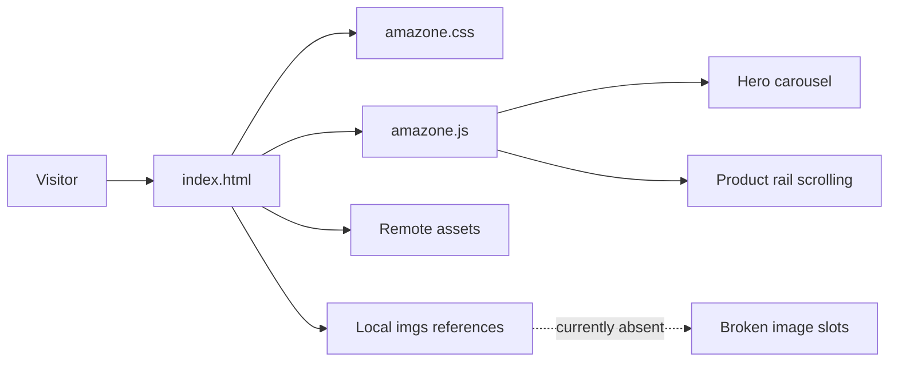

# 📚 Documentation Hub

Welcome to the technical documentation for **Amazon Clone**, a static storefront interface built with HTML, CSS, and vanilla JavaScript.

> [!IMPORTANT]
> This repository is a frontend demonstration. It does not implement a real marketplace, user accounts, search, cart persistence, checkout, payments, inventory, or order processing.

## 🧭 Start here

| Goal | Document |
|---|---|
| Understand the project and its boundaries | [Project overview](project-overview.md) |
| Understand browser-side architecture | [Architecture](architecture.md) |
| Navigate the files and folders | [Project structure](project-structure.md) |
| Understand page and interaction flows | [Workflow](workflow.md) |
| Understand elements and current behaviours | [Feature reference](features.md) |
| Run and modify the project | [Installation](installation.md), [Development](development.md) |
| Understand browser data movement | [Data flow](data-flow.md) |
| Understand test coverage | [Quality assurance](QA.md) |
| Review accessibility and security | [Accessibility](ACCESSIBILITY.md), [Security review](SECURITY-REVIEW.md) |
| Review external and missing images | [Asset inventory](ASSET-INVENTORY.md) |
| Understand absent backend capabilities | [API status](api.md), [Database status](database.md) |
| Publish the static site | [Deployment](deployment.md) |
| Diagnose common problems | [Troubleshooting](troubleshooting.md), [FAQ](faq.md) |
| Understand current constraints and possible evolution | [Limitations](limitations.md), [Future scope](future-scope.md), [Roadmap](../ROADMAP.md) |

## 🧱 System at a glance



## 🧪 Quality checks

Run from the repository root:

```bash
node --check amazone.js
node --test tests/*.test.js
python scripts/check_html.py
```

See [QA](QA.md) for scope and manual checks.

## 📝 Documentation principles

- Describe observed behaviour, not intended or imagined behaviour.
- Label future capabilities as proposals, never as implemented features.
- Keep diagrams aligned with the files and interactions that exist.
- Document third-party assets and licensing uncertainty.
- Update this index when adding, removing, or renaming documentation.
