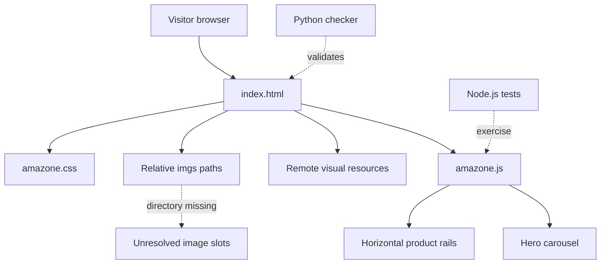

# 📚 Documentation Hub

Welcome to the technical documentation for **Amazon Clone**, an independent static storefront prototype built with HTML, CSS, and vanilla JavaScript.

> [!IMPORTANT]
> This repository demonstrates a browser-side interface. It does not implement a real marketplace, user accounts, search, cart persistence, checkout, payments, inventory, or order processing.

## 🧭 Documentation map

| Topic | Primary guide | What it answers |
|---|---|---|
| Product purpose | [Project Overview](project-overview.md) | Why the prototype exists and what it does not do |
| Repository navigation | [Project Structure](project-structure.md) | Which files and directories exist and why |
| Runtime architecture | [Architecture](architecture.md) | How HTML, CSS, JavaScript, and external resources relate |
| Design constraints | [System Design](system-design.md) | Current boundaries and decision criteria |
| Browser interaction | [Workflow](workflow.md) | How the page loads and how interactions work |
| Feature status | [Feature Reference](features.md) | Implemented versus presentation-only behaviour |
| Browser state | [Data Flow](data-flow.md) | Where static content and runtime state originate |
| Setup | [Installation](installation.md) | How to run the static page |
| Coding | [Development Guide](development.md) | How to modify and validate the source |
| Test approach | [Testing Strategy](testing-strategy.md) | Automated and manual coverage |
| QA checklist | [Quality Assurance](QA.md) | Release-level validation |
| Deployment | [Deployment](deployment.md) | Publishing the static site |
| Operations | [Maintenance](maintenance.md) | Keeping source and deployment healthy |
| Diagnostics | [Observability](observability.md) | What can be inspected and what is not monitored |
| Accessibility | [Accessibility Notes](ACCESSIBILITY.md) | Current semantics and known gaps |
| Accessibility tests | [Accessibility Test Plan](accessibility-test-plan.md) | Keyboard, screen-reader, visual checks |
| Security | [Security Review](SECURITY-REVIEW.md) | Current threat boundaries |
| API status | [API Guide](api.md) | Current absence of application endpoints |
| Persistence | [Database Guide](database.md) | Current absence of a database |
| Assets | [Asset Inventory](ASSET-INVENTORY.md) | Missing local image paths and rights tracking |
| Constraints | [Limitations](limitations.md) | Known defects and non-goals |
| Future direction | [Future Scope](future-scope.md) and [Roadmap](../ROADMAP.md) | Proposed improvements and decision gates |
| Support | [Troubleshooting](troubleshooting.md), [FAQ](faq.md) | Common setup and behaviour problems |
| Terminology | [Glossary](glossary.md) | Terms used in this repository |
| Documentation quality | [Documentation Maintenance](documentation-maintenance.md) | How docs must be kept accurate |
| Architecture decision | [ADR 0001](adr/0001-static-frontend-prototype.md) | Why the project remains static |

## 🧱 Current system at a glance



## 🧪 Standard validation commands

Run from the repository root:

```bash
node --check amazone.js
node --test tests/*.test.js
python scripts/check_html.py
python scripts/check_docs.py
```

These commands validate JavaScript syntax, the mock-DOM interaction tests, and selected HTML/local-reference rules. They do not replace real browser, responsive, network, or accessibility testing.

## 🧭 How to read implementation status

- **Implemented:** present in the tracked source and testable.
- **Presentation-only:** visible UI without the expected application action.
- **Not implemented:** no current implementation exists.
- **Proposed:** future work without a delivery commitment.
- **Known limitation:** a current constraint or defect that should remain visible until resolved.

## 📝 Keeping documentation useful

Documentation should be long enough to explain the actual project, not padded with generic content. Keep commands runnable, diagrams factual, links valid, and all future capabilities clearly labelled. Update the project tree when paths change and the asset inventory whenever media changes.

See [Documentation Maintenance](documentation-maintenance.md).
