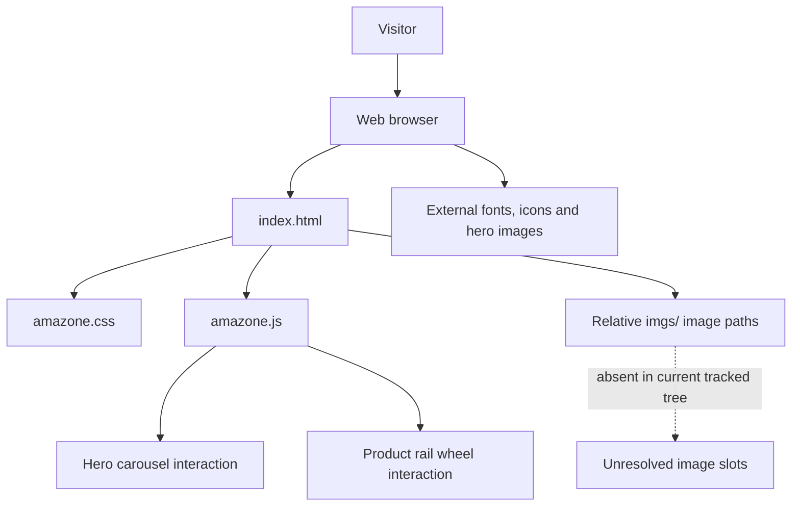

# 🏗️ Architecture

## 1. Scope and architectural style

Amazon Clone is a single-page static storefront prototype. The browser loads an HTML document, a stylesheet, a JavaScript file, and referenced visual resources. There is no application server or backend service in the repository.

The architecture is intentionally small and browser-native. It should not be described as a MERN application, microservice system, or production marketplace.

## 2. High-level context

## 3. Source responsibilities

| Component | Responsibility | Current boundary |
|---|---|---|
| `index.html` | Page content, navigation, carousel markup, category cards, product cards, footer | Static markup |
| `amazone.css` | Layout, colours, typography, responsive rules, rail overflow | Presentation only |
| `amazone.js` | Carousel state and wheel-assisted rail scrolling | Browser memory and DOM |
| `tests/amazone.test.js` | Behaviour tests using a mock DOM | Development only |
| `scripts/check_html.py` | HTML structure and local path validation | Development only |
| `.github/workflows/ci.yml` | Automated syntax, test, and HTML checks | CI only |

## 4. Browser startup sequence

1. The browser requests `index.html`.
2. The HTML parser reads metadata and stylesheet references.
3. The browser requests `amazone.css` and the external icon stylesheet.
4. The browser resolves image sources, including remote and relative local paths.
5. The browser reaches the script at the end of the body and loads `amazone.js`.
6. JavaScript queries carousel slides, previous/next controls, and product rails.
7. The first carousel slide is displayed when slides exist.
8. Event handlers are attached to available controls and rails.

Serving the project from its root is important because relative references use the document path as their base.

## 5. Interaction architecture

### Carousel

The carousel uses a local integer index. The requested index is wrapped into the available slide range. Every slide is updated so that only the active one is displayed, and its `aria-hidden` attribute is updated when supported.

### Product rails

Each element matching `.products` receives a wheel handler. The handler only translates a vertical-dominant wheel event when the rail can actually move. The candidate scroll position is clamped between zero and the maximum horizontal scroll offset. At a boundary, the default page scroll remains available.

## 6. State and data model

There is no persistent catalog, account, cart, or order state.

| State | Owner | Lifetime |
|---|---|---|
| Active hero slide | Local variable in `amazone.js` | Current page runtime |
| Product rail offset | Browser element | Current rendered page |
| Product/category text | HTML document | Repository revision |
| Viewport dimensions | Browser/CSS layout engine | Current viewport |
| External asset response | Browser/network cache | Browser-controlled |

## 7. External resource and trust boundary

Remote images, fonts, and icons are fetched from third-party hosts. Their uptime, content, licensing, and privacy practices are not controlled by this repository. The local `imgs/` paths are currently unresolved because the directory is absent from the tracked tree.

See [Asset Inventory](ASSET-INVENTORY.md) and [Security Review](SECURITY-REVIEW.md).

## 8. Testing boundaries

The Node.js tests exercise JavaScript logic with a mock DOM. They do not emulate a full browser rendering engine. The Python checker validates document structure and local references, but it does not test visual layout, network availability, keyboard interaction, or screen-reader output.

## 9. Architectural constraints

- Keep the current solution simple while the feature scope remains static.
- Avoid introducing a framework or backend without a concrete requirement.
- Keep browser code free of privileged credentials.
- Do not treat client-side values as trusted commercial data.
- Update diagrams whenever actual runtime boundaries change.

## 10. Related decisions

See [ADR 0001: Static Frontend Prototype](adr/0001-static-frontend-prototype.md) for the recorded decision to retain the current architecture.
