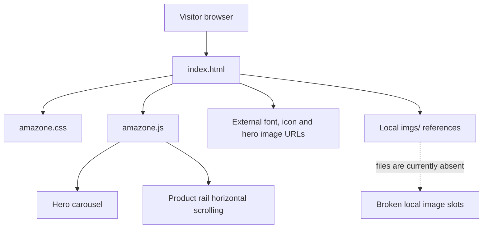

# Architecture

## System shape

Amazon Clone is a single-page static storefront. The browser loads one HTML document, one stylesheet, and one JavaScript file. There is no server-side application layer in the repository.

## Responsibilities

| File | Responsibility |
| --- | --- |
| `index.html` | Navigation, hero carousel markup, category cards, product rails, footer |
| `amazone.css` | Layout, typography, colors, product rail and responsive presentation |
| `amazone.js` | Hero image selection and wheel-to-horizontal-scroll interaction |
| `tests/amazone.test.js` | Dependency-free JavaScript behaviour tests |
| `scripts/check_html.py` | HTML structure and local-reference validation |

## Runtime flow

1. The browser loads `index.html`.
2. The page downloads `amazone.css` and the Font Awesome stylesheet.
3. Remote hero images and icon/font resources are requested from their third-party hosts.
4. Local image paths are resolved relative to the document URL.
5. `amazone.js` chooses the first hero image and binds controls, then binds wheel handlers to product rails.

The page must be served from the project root so relative paths such as `./amazone.css`, `./amazone.js`, and `imgs/...` resolve as intended.

## State and data

There is no persistent state, catalog model, search index, cart store, user session, API client, or database. Product names, prices, promotional labels, and layout are static markup.

## External dependencies and trust boundaries

Remote imagery, fonts, and icons depend on third-party services. The repository does not control their uptime, content, licensing, or privacy behaviour. See [Asset inventory](ASSET-INVENTORY.md) and [Security review](SECURITY-REVIEW.md).
