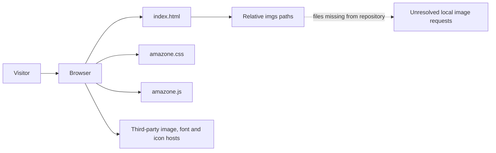
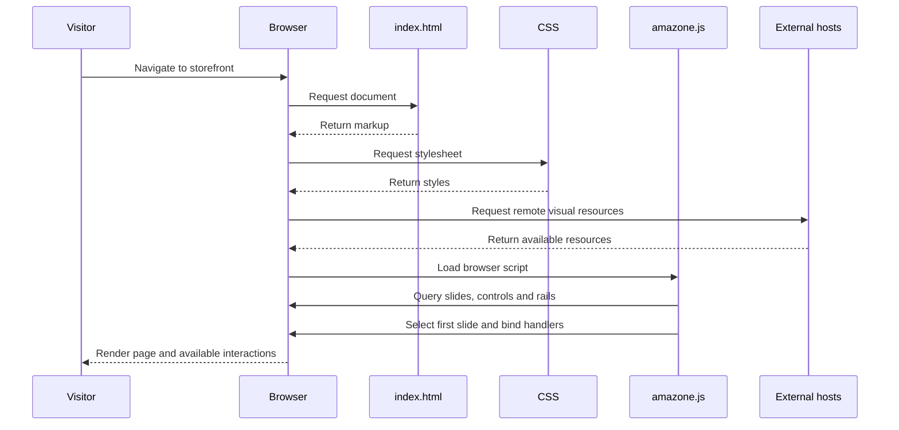

# 🔀 Data Flow and Browser State

## 1. Purpose

This document records what information is present in the current storefront, where it originates, how browser interactions transform it, and what is deliberately not persisted.

The current application is a static frontend. It has no application API, database, product service, user session, authentication provider, or persistent storage layer.

## 2. System context

## 3. Current data inventory

| Information | Source | Consumer | Persistence |
|---|---|---|---|
| Navigation labels | Literal HTML text | Browser DOM | Repository only |
| Category headings | Literal HTML text | Category cards | Repository only |
| Product descriptions | Literal HTML text | Product cards | Repository only |
| Displayed prices and discounts | Literal HTML text | Deal cards | Repository only |
| Hero image URLs | HTML `src` attributes | Browser image loader | No application persistence |
| Active slide index | Local JavaScript variable | Carousel function | Page memory only |
| Product rail position | DOM element `scrollLeft` | Browser layout/scrolling | Element runtime only |
| Viewport width | Browser viewport | CSS media queries | Browser environment |
| Font/icon resources | External URLs | Browser renderer | Browser cache may apply |

## 4. Page-load sequence

Local images are resolved relative to the document URL. Missing paths result in failed resource requests and broken image presentation.

## 5. Carousel data flow

**Input:** a click event on the previous or next button.

**State:** `activeSlide`, a local integer index.

**Transformation:**
1. Add -1 or +1 depending on the activated control.
2. Wrap the requested index into the valid slide range.
3. Iterate over the slide collection.
4. Display the active slide and hide the others.
5. Update `aria-hidden` where the element supports `setAttribute`.

**Output:** one visible slide. No network request or persistent storage write is performed by the carousel logic itself.

## 6. Product rail data flow

**Input:** a wheel event on a product rail.

**Transformation:**
1. Ignore absent events and events where horizontal movement is at least as strong as vertical movement.
2. Calculate the rail's maximum scroll offset.
3. Calculate a candidate position using the current `scrollLeft` plus `deltaY`.
4. Clamp the candidate position between zero and the maximum.
5. If the position cannot change, allow the browser's normal page scroll.
6. Otherwise prevent the default wheel action and update `scrollLeft`.

**Output:** a changed horizontal offset for that DOM element. No product data is fetched or modified.

## 7. No current data flow for commerce operations

The repository does not currently process:
- User credentials or profile data.
- Search requests or search result records.
- Cart line items or quantities.
- Shipping addresses.
- Inventory reservations.
- Payment tokens or payment results.
- Orders, refunds, or customer support records.

Do not draw these as existing runtime services or claim they are protected by controls that have not been implemented.

## 8. Future data design guardrails

If product data becomes dynamic, define a schema and trusted source. If user-specific operations are introduced, define identity, authorization, validation, persistence, retention, and deletion requirements before implementation. Prices, discounts, inventory, order totals, and payment states must be server-authoritative in any real commerce system.

## 9. Related references

- [Architecture](architecture.md)
- [API status](api.md)
- [Database status](database.md)
- [Security review](SECURITY-REVIEW.md)
- [System design](system-design.md)
