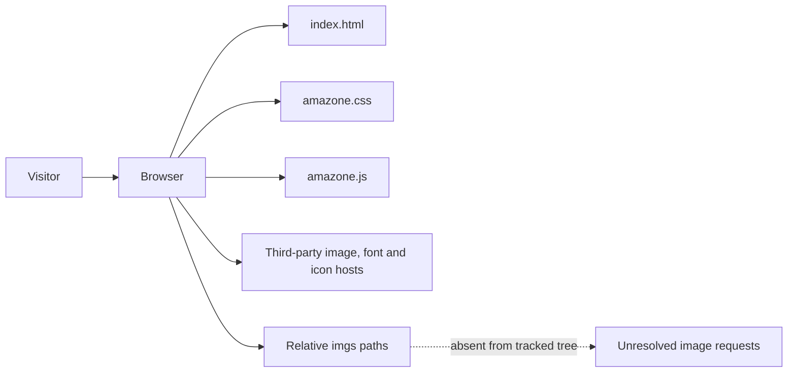
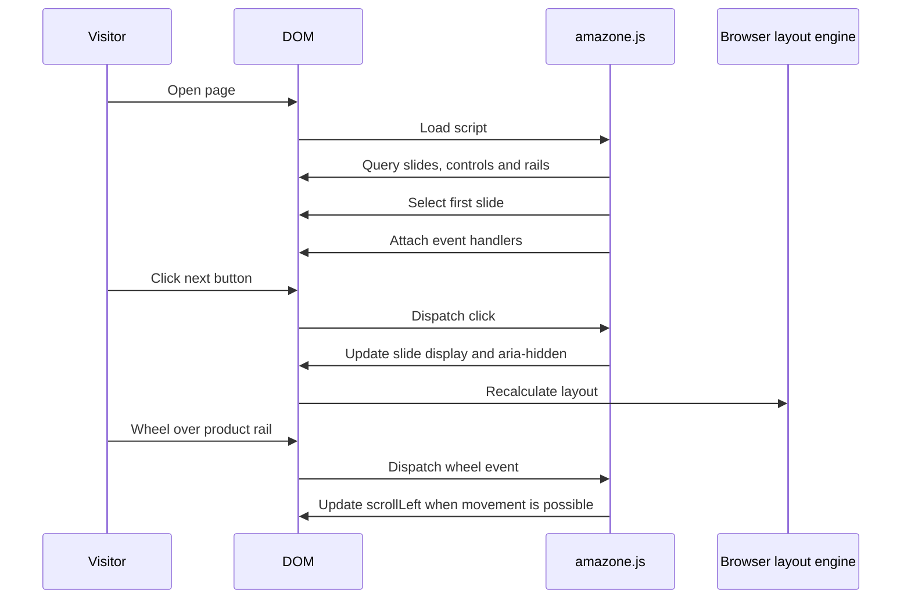

# 🔀 Data Flow and Browser State

## 1. Current data architecture

The current project is a static frontend. It has no application API, database, product service, user session, authentication provider, or persistent storage layer.

Most content is literal markup in `index.html`. Browser state is limited to the active carousel slide index and the native scroll position of each product rail.

## 2. Context diagram

## 3. UI data flow

| Data or state | Source | Consumer | Persistence |
|---|---|---|---|
| Navigation labels | HTML text | Browser DOM | None |
| Category labels | HTML text | Category cards | None |
| Product names/prices | HTML text | Product cards | None |
| Hero image URLs | HTML attributes | Browser image loader | None |
| Active slide index | Local JS variable | Carousel function | Memory only |
| Rail scroll position | Browser element state | CSS overflow and wheel handler | Browser element only |
| Viewport width | Browser viewport | CSS media queries | Browser environment |
| Fonts/icons | External URLs | Browser resource loader | Browser cache may apply |

## 4. Interaction sequence

## 5. Inputs, transformations, and outputs

### Carousel

- **Input:** A click event and a direction of -1 or +1.
- **Transformation:** Add direction to active index and wrap it to the slide count.
- **Output:** One visible image, with other slides hidden and their `aria-hidden` state updated.

### Product rail

- **Input:** A wheel event with `deltaX` and `deltaY`.
- **Transformation:** Compare movement axes, clamp the candidate scroll position to [0, maximum scroll].
- **Output:** Update `scrollLeft` and prevent the default vertical action only when the rail can actually move.

## 6. No data flow exists for commerce operations

There are no current flows for credentials, user profiles, search queries, cart line items, order records, inventory quantities, payment details, or addresses. Do not draw these as existing components in architecture diagrams.

## 7. Future data design guardrails

Any future data-driven catalog should define a schema, validation rules, error states, loading states, and a trustworthy source of pricing and availability. Any user-specific or order-related capability must be backed by server-side authorization and data controls. Sensitive credentials must never be embedded in browser code.
