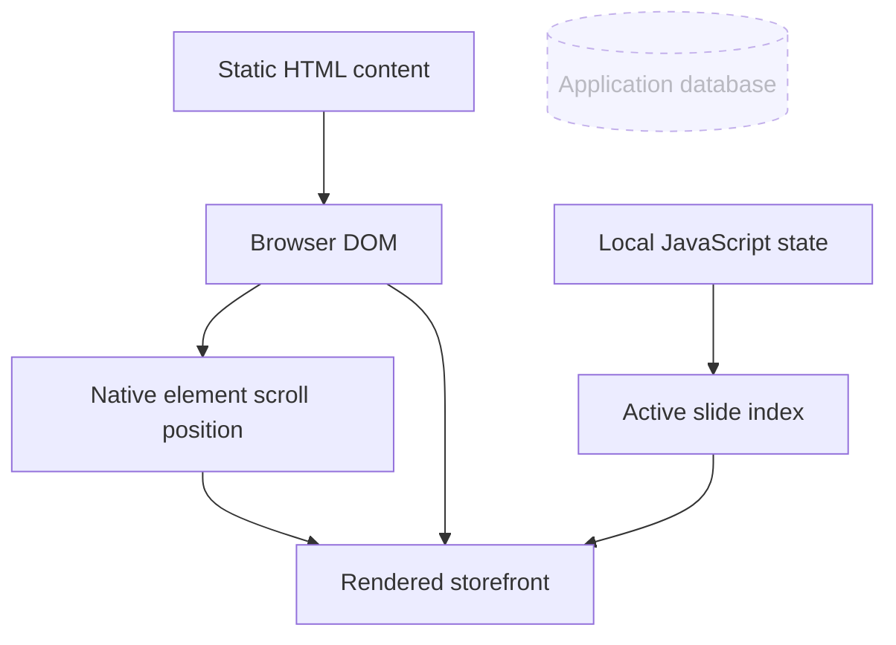

# 🗄️ Database and Persistence Status

## 1. Current status

The current project has **no database and no persistence layer**. It is a static frontend prototype composed of HTML, CSS, and vanilla JavaScript.

There is no SQL database, document database, browser database, backend data service, or ORM in the repository. No database connection string or credential is required to run the current page.

## 2. Data currently stored in the repository

The following values are authored directly in `index.html`:

- Navigation labels and display text.
- Category headings.
- Product card headings.
- Illustrative price and discount text.
- Image references and other static content.

The carousel's active index is a local JavaScript variable. Product rail scroll offsets are maintained by browser DOM elements. These values are not written to a persistent application store.

## 3. Data that is not stored

The project does not store:
- Customer accounts or passwords.
- Authentication sessions.
- Delivery addresses.
- Product inventory or authoritative pricing.
- Shopping cart contents.
- Payment details or payment status.
- Orders, returns, or refunds.
- Search history or user preferences.

## 4. Current persistence model

The database node is intentionally shown as absent. The diagram must not be interpreted as a database integration.

## 5. Future schema considerations

A future backend would need a requirements-led data model. Potential entities might include products, categories, inventory records, user identities, carts, orders, order items, and payment references. Their exact fields, relationships, retention rules, and access policies must be designed before implementation.

Do not create tables solely because they are common in e-commerce systems. Define ownership, lifecycle, constraints, and transactional requirements for each entity.

## 6. Data integrity and security requirements for a future system

Any persistent commerce system should define:
- Primary and foreign key strategy.
- Uniqueness and check constraints.
- Migration and rollback process.
- Server-side validation.
- Authorization for user-owned records.
- Transaction boundaries and concurrency behaviour.
- Backup, restore, and disaster recovery.
- Retention, deletion, and privacy controls.
- Auditability without logging sensitive values.
- Encryption and credential management appropriate to the deployment.

Browser JavaScript must never connect directly to a privileged database or contain database credentials.

## 7. Environment configuration

The current static application does not read environment variables. The repository's `.env.example` is a reminder and must not be filled with real secrets. If a backend is introduced, document environment variables by name and purpose while keeping secret values in a secure deployment secret store.

## 8. Related documentation

See [API Status](api.md), [Data Flow](data-flow.md), [Architecture](architecture.md), and [Security Review](SECURITY-REVIEW.md).
