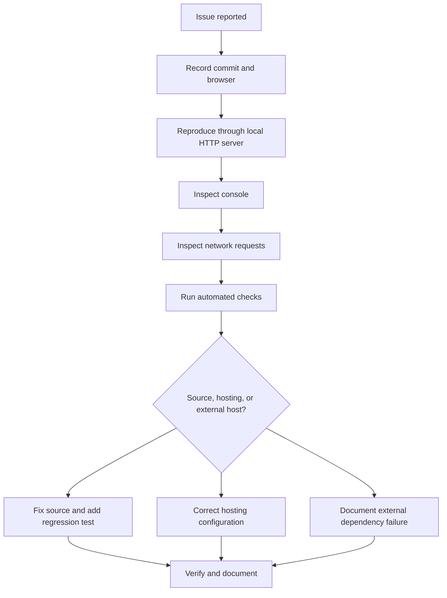

# 🔎 Diagnostics and Observability

## 1. Current observability status

The repository does not include application telemetry, structured logging, an error-reporting SDK, server metrics, a health endpoint, or a backend service. It runs as a static page in the visitor's browser.

The available diagnostics are the browser's developer tools, local test output, the HTML checker, and GitHub Actions results.

## 2. Diagnostic sources

| Source | What it can reveal | What it cannot prove |
|---|---|---|
| Browser console | JavaScript exceptions, warnings, resource errors | Complete user experience or backend state |
| Network panel | Failed HTML/CSS/JS/image/font requests and response status | Whether a third-party asset is licensed |
| Responsive device mode | Layout at selected viewport dimensions | Every physical device behaviour |
| Node test output | Behaviour covered by the mock-DOM test suite | Real browser layout and assistive technology output |
| Python HTML checker | Basic structure, duplicate IDs, local reference failures | Full HTML conformance or visual correctness |
| GitHub Actions | Whether configured checks passed for a revision | Unconfigured manual or production checks |

## 3. Troubleshooting workflow

## 4. Privacy and diagnostic data

Do not collect analytics or session replay by default. If telemetry is ever proposed, define:
- The exact operational question it answers.
- The minimum fields required.
- Whether data can identify a visitor.
- Retention and deletion periods.
- Disclosure and consent requirements.
- Access controls and incident handling.

Never collect passwords, payment data, or sensitive form values for debugging. Screenshots and logs must be sanitized before sharing.

## 5. Future monitoring considerations

A browser error-reporting service may be justified only if the deployed application has enough usage and operational need to warrant it. A static prototype does not currently justify another runtime dependency.

If a backend is introduced, monitoring must be designed around service health, request failures, latency, resource capacity, data integrity, security events, and privacy-safe audit trails. Those are future requirements, not existing capabilities.

## 6. Incident evidence template

When reporting an issue, record:
- Affected page and browser.
- Commit or deployment revision.
- Reproduction steps.
- Expected and observed result.
- Console/network evidence with private values removed.
- Whether the issue occurs locally and on the deployed site.
- Whether it is repeatable or intermittent.

See [Support](../SUPPORT.md) and [Troubleshooting](troubleshooting.md).
