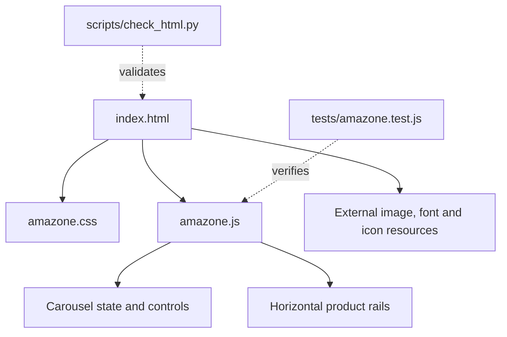

# 🗂️ Project Structure and File Responsibilities

This page describes the repository structure observed in the `main` branch. It is not a generic template. Directory additions should remain tied to actual project needs.

## 1. Current tree

```text
Amazon_Clone/
├── .github/
│   ├── ISSUE_TEMPLATE/
│   │   ├── bug_report.yml
│   │   └── feature_request.yml
│   ├── workflows/
│   │   ├── ci.yml
│   │   └── update-readme.yml
│   ├── PULL_REQUEST_TEMPLATE.md
│   └── dependabot.yml
├── .idea/
│   └── .gitignore
├── docs/
│   ├── ACCESSIBILITY.md
│   ├── ASSET-INVENTORY.md
│   ├── QA.md
│   ├── SECURITY-REVIEW.md
│   ├── api.md
│   ├── architecture.md
│   ├── database.md
│   ├── deployment.md
│   ├── development.md
│   ├── faq.md
│   ├── installation.md
│   └── troubleshooting.md
├── scripts/
│   └── check_html.py
├── tests/
│   └── amazone.test.js
├── .editorconfig
├── .env.example
├── .gitignore
├── CHANGELOG.md
├── CITATION.cff
├── CODEOWNERS
├── CODE_OF_CONDUCT.md
├── CONTRIBUTING.md
├── LICENSE
├── README.md
├── RELEASE-CHECKLIST.md
├── ROADMAP.md
├── SECURITY.md
├── SUPPORT.md
├── amazone.css
├── amazone.js
└── index.html
```

The documentation files added alongside this page are listed in [Documentation Hub](README.md).

## 2. Root files

| File | Responsibility |
|---|---|
| `index.html` | Single-page storefront markup and static content |
| `amazone.css` | Global styles, component-like selectors, responsive rules |
| `amazone.js` | Carousel and horizontal product rail interaction |
| `README.md` | Repository introduction and quick-start entry point |
| `LICENSE` | Repository licensing terms |
| `.env.example` | Environment example retained in the repository; no application backend is currently configured |
| `.gitignore` | Files excluded from version control |
| `.editorconfig` | Basic editor consistency settings |
| `CHANGELOG.md` | Change history |
| `ROADMAP.md` | Planned and proposed work |
| `RELEASE-CHECKLIST.md` | Release preparation checklist |
| `CONTRIBUTING.md` | Contributor workflow and expectations |
| `SECURITY.md` | Vulnerability reporting guidance |
| `SUPPORT.md` | Support and troubleshooting entry points |
| `CODE_OF_CONDUCT.md` | Community behaviour expectations |
| `CITATION.cff` | Citation metadata |
| `CODEOWNERS` | Ownership rules for review routing |

## 3. Supporting directories

### `.github/`

Contains issue forms, the pull request template, Dependabot configuration, and GitHub Actions workflows. Workflows should be checked against the actual commands and permissions before they are extended.

### `docs/`

Contains architecture, setup, development, deployment, asset, accessibility, security, API-status, database-status, QA, and support documentation.

### `scripts/`

Contains `check_html.py`, a Python validation utility. It is not part of the browser runtime.

### `tests/`

Contains `amazone.test.js`, which exercises the JavaScript behaviour with a dependency-free test harness.

## 4. Runtime dependency map



## 5. Loading order

1. The browser requests `index.html`.
2. The document requests `amazone.css` and the externally hosted icon stylesheet.
3. The browser resolves remote and local image references.
4. The browser loads `amazone.js` at the end of the body.
5. The script discovers carousel slides, controls, and product rails, then binds interactions.

## 6. Structure rules for future changes

- Keep browser runtime files at the root unless a refactor has a clear benefit.
- Keep tests separate from runtime code.
- Put explanatory material in `docs/`, not in arbitrary root-level files.
- Keep approved visual assets in a clearly named asset directory once their rights and files are verified.
- Do not add a backend, database, environment secrets, or package manager configuration unless implementation work actually introduces those systems.
- Update this tree whenever tracked paths change.
