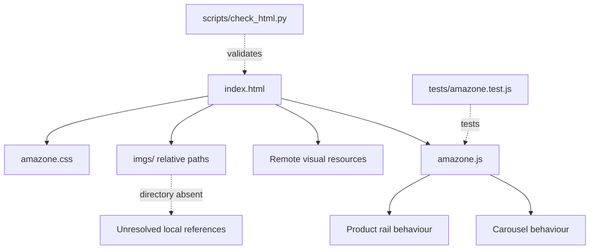

# 🗂️ Project Structure and File Responsibilities

## 1. Purpose and source of truth

This document explains the tracked repository layout and the responsibility of each major file. The tree should be updated whenever paths are added, renamed, or removed. It is not a suggested generic structure for a different application.

## 2. Repository tree

```text
Amazon_Clone/
├── .github/
│   ├── ISSUE_TEMPLATE/
│   │   ├── bug_report.yml
│   │   ├── documentation.yml
│   │   └── feature_request.yml
│   ├── workflows/
│   │   ├── ci.yml
│   │   ├── docs-check.yml
│   │   └── update-readme.yml
│   ├── PULL_REQUEST_TEMPLATE.md
│   └── dependabot.yml
├── .idea/
│   └── .gitignore
├── docs/
│   ├── adr/
│   │   └── 0001-static-frontend-prototype.md
│   ├── ACCESSIBILITY.md
│   ├── ASSET-INVENTORY.md
│   ├── QA.md
│   ├── SECURITY-REVIEW.md
│   ├── README.md
│   ├── accessibility-test-plan.md
│   ├── api.md
│   ├── architecture.md
│   ├── data-flow.md
│   ├── database.md
│   ├── deployment.md
│   ├── development.md
│   ├── documentation-maintenance.md
│   ├── faq.md
│   ├── features.md
│   ├── future-scope.md
│   ├── glossary.md
│   ├── installation.md
│   ├── limitations.md
│   ├── maintenance.md
│   ├── observability.md
│   ├── project-overview.md
│   ├── project-structure.md
│   ├── system-design.md
│   ├── testing-strategy.md
│   ├── troubleshooting.md
│   └── workflow.md
├── scripts/
│   ├── check_docs.py
│   └── check_html.py
├── tests/
│   └── amazone.test.js
├── .editorconfig
├── .env.example
├── .gitignore
├── CHANGELOG.md
├── CITATION.cff
├── CODEOWNERS
├── CODE_OF_CONDUCT.md
├── CONTRIBUTING.md
├── LICENSE
├── README.md
├── RELEASE-CHECKLIST.md
├── ROADMAP.md
├── SECURITY.md
├── SUPPORT.md
├── amazone.css
├── amazone.js
└── index.html
```

## 3. Browser runtime files

### `index.html`

The main document contains the navigation, search-like input, carousel controls and images, category cards, product rails, deal cards, footer, stylesheet references, and script reference.

The product and promotional text is static. Some visible links are placeholders. The page references local files under `imgs/`, but the directory is not present in the tracked tree.

### `amazone.css`

The stylesheet controls global reset rules, typography, navigation, carousel positioning, card layout, product rail overflow, footer presentation, and responsive rules at 900px, 600px, and 380px.

### `amazone.js`

The script queries carousel slides, controls, and product rails. It selects the first slide, binds previous/next click handlers, and attaches a wheel handler to each product rail.

## 4. Development support directories

### `.github/`

Contains issue forms, pull request guidance, Dependabot configuration, and GitHub Actions workflows. These files support repository collaboration and automated checks. They are not loaded by the browser.

### `docs/`

Contains the documentation hub and technical, product-scope, quality, accessibility, security, asset, deployment, and maintenance references.

### `docs/adr/`

Contains architecture decisions and their context, consequences, and reconsideration criteria.

### `scripts/`

Contains two Python standard-library validation utilities. `check_html.py` checks document structure and local resource references; `check_docs.py` checks Markdown file presence and local relative links. Neither script is part of the browser runtime.

### `tests/`

Contains the Node.js built-in test suite. Tests use a mock DOM to exercise browser interaction logic without a third-party test framework.

## 5. Runtime dependency diagram



## 6. GitHub automation

| File | Purpose |
|---|---|
| `.github/workflows/ci.yml` | Validates entry files, JavaScript syntax, tests, and HTML references |
| `.github/workflows/docs-check.yml` | Performs basic documentation checks |
| `.github/workflows/update-readme.yml` | Updates the README timestamp on its configured schedule or manual dispatch |
| `.github/dependabot.yml` | Checks GitHub Actions dependencies |
| `.github/ISSUE_TEMPLATE/bug_report.yml` | Collects reproducible defect reports |
| `.github/ISSUE_TEMPLATE/feature_request.yml` | Collects enhancement proposals |
| `.github/ISSUE_TEMPLATE/documentation.yml` | Collects documentation improvements |
| `.github/PULL_REQUEST_TEMPLATE.md` | Guides contribution review |

## 7. Root governance and metadata

The root contains the README, software licence, contribution guide, code of conduct, security policy, support guide, changelog, roadmap, release checklist, citation metadata, code owners, editor configuration, environment example, and Git ignore rules.

## 8. Structure maintenance rules

- Keep browser runtime code separate from tests and tooling.
- Put project knowledge in `docs/`.
- Keep diagrams consistent with actual tracked components.
- Add assets only after rights and source are verified.
- Do not add backend or database folders until those systems exist.
- Do not create empty directories that Git cannot track.
- Update this tree and documentation hub whenever paths change.
