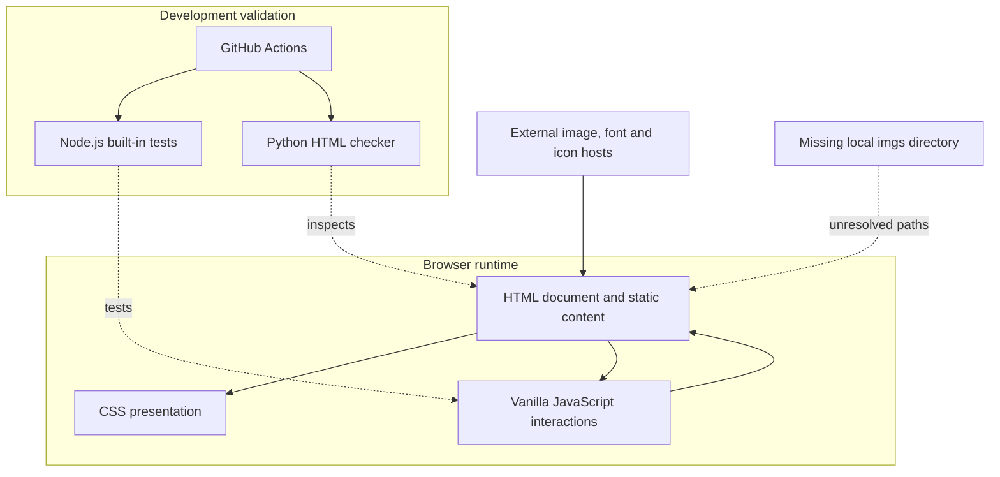

# 🧩 System Design Notes

## 1. Design scope

This document describes the current static storefront and the design constraints that should guide future changes. It is not a specification for a production commerce backend.

## 2. Current system context

The component boundaries are file-level boundaries. There is no separate frontend service, backend service, or database.

## 3. Runtime responsibilities

| Component | Input | Processing | Output |
|---|---|---|---|
| HTML document | Repository markup | Browser parsing | DOM structure and static text |
| CSS stylesheet | DOM and viewport | Selector matching and layout | Visual presentation |
| Carousel script | Click events and slide collection | Active index calculation | Visible slide and ARIA state |
| Product rail handler | Wheel event and element dimensions | Axis comparison and clamped scroll calculation | Updated horizontal offset |
| External resources | Browser HTTP requests | Third-party host response | Images, fonts, and icons when available |

## 4. State model

- Carousel state is a local integer held in the JavaScript closure.
- Product rail positions are native DOM element properties.
- Static product and category content is held in the HTML document.
- Responsive presentation is calculated by the browser from CSS media queries.
- There is no persistent user state or server-side data model.

## 5. Quality and scaling considerations

The current design is appropriate for a small learning prototype. As the page grows, duplicated product markup may become difficult to maintain. A small local data structure and a reusable rendering function could reduce repetition, but should be introduced with a clear schema, safe DOM construction, and tests.

Adding a framework or backend without a concrete requirement would increase setup and maintenance costs without solving a demonstrated problem.

## 6. Current design constraints

| Concern | Current design | Consequence |
|---|---|---|
| Catalog | Static HTML | Manual content updates |
| Search | No implementation | No product discovery/filtering |
| Account | No implementation | No identity or access control |
| Cart | No implementation | No purchase intent persistence |
| Payment | No implementation | No transaction handling |
| Inventory | No implementation | No stock authority |
| Images | Missing local paths and remote URLs | Broken image slots and external dependency |
| State | Browser memory and DOM | No persistence |
| Tests | Mock DOM and static checker | No real browser automation |

## 7. Future architecture decision gates

Before introducing a data service, decide:
- Whether static data remains sufficient.
- What user problem requires dynamic behaviour.
- Which component owns each data field.
- What needs to persist and for how long.
- What security boundary is required.
- How failures and retries behave.
- How the feature will be tested and operated.

A real marketplace requires separate design for server-side catalogue, identity, authorization, cart, inventory, orders, payments, privacy, monitoring, and incident response.

## 8. Non-goals

Do not add distributed-system components, queues, caching services, databases, payment gateways, or microservices to diagrams as if they already exist. Keep current architecture diagrams factual.

## 9. Related decision

See [ADR 0001](adr/0001-static-frontend-prototype.md) for the decision to retain a dependency-light static frontend until a concrete requirement justifies a change.
