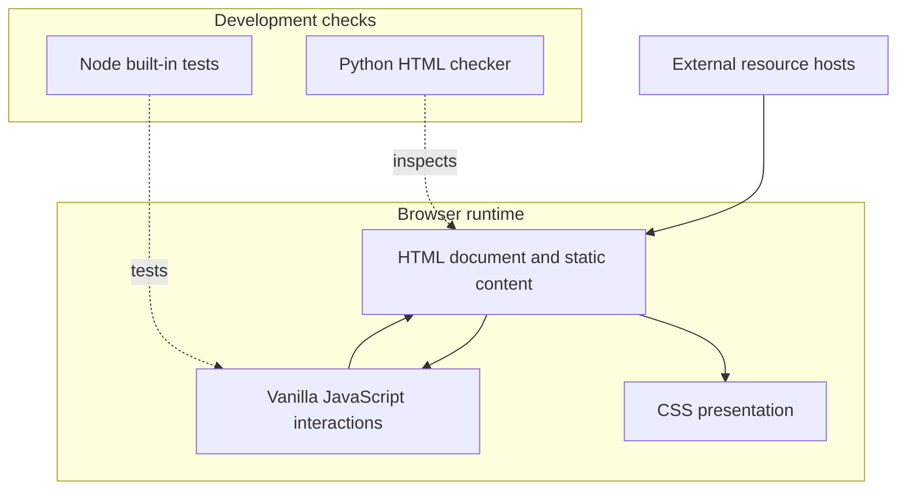

# 🧩 System Design Notes

## 1. Design scope

This document describes the current static storefront and records constraints for future evolution. It is not a design for a deployed commerce backend.

## 2. Current component boundaries

The component boundaries are file-level boundaries. The project does not currently have separate frontend and backend services.

## 3. Runtime characteristics

- Static resources are loaded by the browser.
- JavaScript runs in the page context.
- Carousel state is held in memory.
- Product rail position is managed by browser elements.
- Product and promotional content is static HTML.
- External resources introduce network and availability dependencies.
- Local image references are unresolved in the current tracked tree.

## 4. Scaling characteristics

The page is appropriate as a small learning prototype. As static content grows, maintainability may become difficult because product cards and labels are duplicated in markup. A lightweight data array and reusable rendering function could reduce repetition, but should be introduced only with tests and a deliberate refactor.

A real marketplace requires a different architecture, including server-side catalog and order services, identity and authorization, persistent storage, inventory consistency, payment-provider integration, observability, abuse prevention, and operational controls.

## 5. Key design constraints

| Concern | Current approach | Constraint |
|---|---|---|
| Catalog | Static HTML | Manual updates; no authoritative feed |
| Interaction state | Browser memory and DOM | Lost on reload |
| Search | No implementation | Cannot discover/filter products |
| Account | No implementation | No identity or access control |
| Cart | No implementation | No purchase intent persistence |
| Payments | No implementation | No transaction handling |
| Images | Local missing paths plus external URLs | Broken slots and third-party dependency |
| Testing | Node test runner and Python checker | No full browser end-to-end suite |

## 6. Proposed evolution sequence

1. Resolve image inventory and usage rights.
2. Improve semantic markup, keyboard operation, and accessibility.
3. Extract repeated product presentation into a small data model.
4. Add meaningful browser tests for new behaviours.
5. Only then define requirements for any API or persistent service.

Avoid adding distributed-system diagrams or infrastructure components that the repository does not contain.
