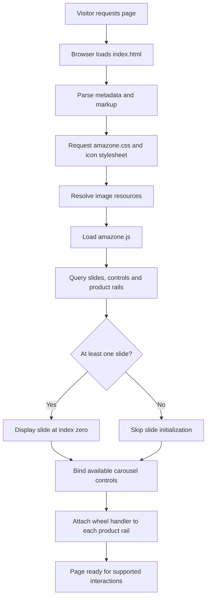
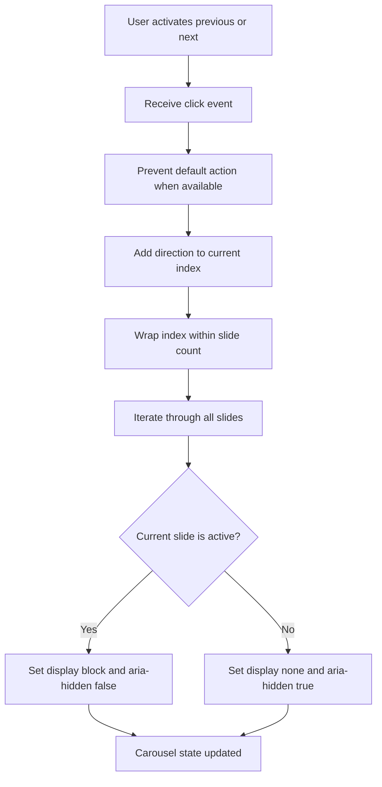
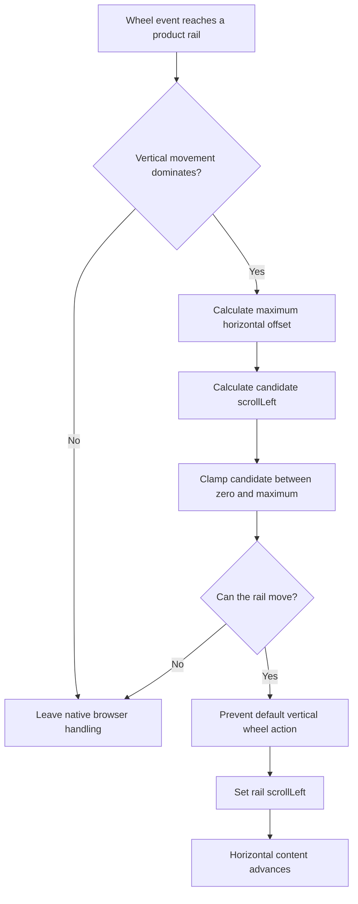
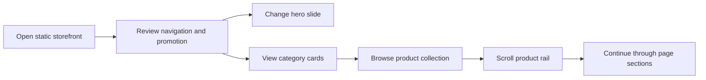

# 🔄 Application Workflow and Interaction Specification

## 1. Scope

The current application workflow is limited to loading a static page and handling two browser interactions: selecting a hero slide and scrolling product rails horizontally. The diagrams below describe existing behaviour, not future e-commerce workflows.

## 2. Initial page load

### Startup details

1. The browser requests the HTML document.
2. The document references the local stylesheet and a remote icon stylesheet.
3. Remote hero and interface resources are requested from their respective hosts.
4. Relative local image references are resolved against the page URL.
5. The JavaScript file is loaded at the end of the body.
6. The script collects the relevant elements and attaches event handlers.
7. The first slide is displayed when the slide collection is non-empty.

A missing local image does not stop the JavaScript carousel from initializing, but it does create a broken visual resource.

## 3. Carousel workflow

The active slide index is held in a local variable. A previous action requests direction -1; a next action requests direction +1.

### Carousel edge cases

| Case | Current behaviour |
|---|---|
| No slides found | No slide update is attempted |
| One slide | Previous/next resolves to the same slide |
| Missing previous control | Previous handler is not attached |
| Missing next control | Next handler is not attached |
| Event has no `preventDefault` method | Script continues without calling it |
| First/last boundary | Index wraps to the opposite end |

The current implementation has no autoplay, swipe gesture, pagination indicator, or persisted slide choice.

## 4. Product rail workflow

The event is not cancelled when the rail cannot move. This is intentional so visitors can continue scrolling the page at the beginning or end of a product row.

## 5. Visitor browsing journey

This is a visual browsing journey only. Category and product anchors are placeholders and do not complete a purchase journey.

## 6. Error and edge-case matrix

| Condition | Handling | User-visible implication |
|---|---|---|
| Empty carousel | Skip slide update | No hero image can be selected |
| Missing control | Skip event binding | That direction cannot be activated |
| Missing local asset | Browser resource failure | Broken image slot |
| External resource unavailable | Browser request fails | Icon, font, logo, or hero image may be absent |
| Rail has no overflow | Candidate offset cannot advance | Page scrolling remains available |
| Wheel movement is horizontal | Handler returns | Native horizontal behaviour remains available |
| Script path fails | No interactions bind | Page remains static |

## 7. Workflows that do not exist

There is no current login, registration, search-results, cart-update, checkout, payment, order, refund, or inventory workflow. Those require a separate feature specification and must not be represented as implemented in this project.

## 8. Test mapping

The current automated tests exercise initial carousel state, next/previous movement, wrap-around, wheel translation, horizontal input passthrough, rail boundary behaviour, missing controls, and multiple rail instances. See [Testing Strategy](testing-strategy.md) for coverage limits and manual test requirements.
