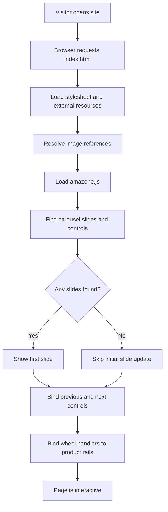
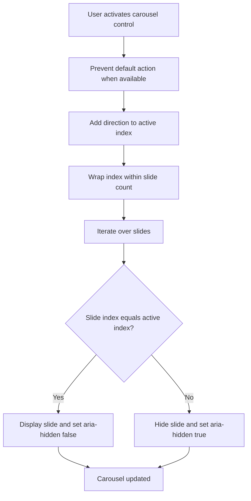
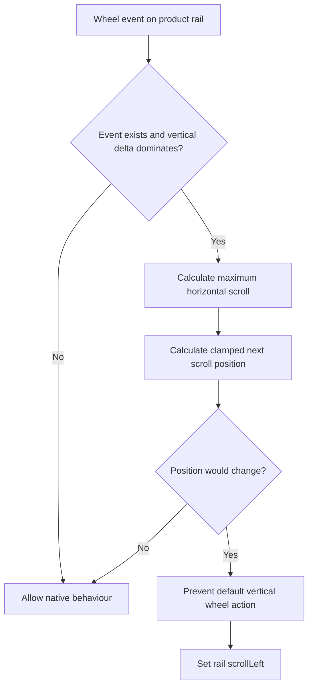
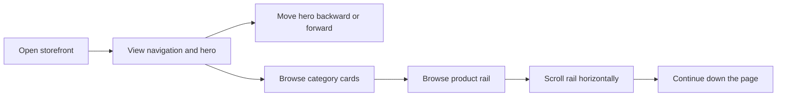

# 🔄 Application Workflow and Interaction Specification

## 1. Overview

The application is a static page. Its workflow is browser-side rendering plus two JavaScript interactions: changing the visible hero slide and scrolling product rails horizontally in response to vertical wheel input.

## 2. Initial page load

## 3. Hero carousel workflow

The JavaScript stores the active slide index in a local variable. The `showSlide` function wraps requested indices using modulo arithmetic so navigation can move from the last slide to the first and vice versa.

**Current implementation details**

- The first slide is selected on startup when slides exist.
- Previous and next buttons are optional guarded controls.
- A missing slide collection does not throw an error.
- Button activation prevents the default event action where the event exposes that method.
- The script does not implement autoplay, pagination dots, swipe gestures, or persisted slide state.

## 4. Product rail wheel workflow

At the left or right boundary, the handler allows the page itself to continue scrolling. Native horizontal trackpad input is not intercepted when its horizontal delta is greater than or equal to its vertical delta.

## 5. User journey map

This journey describes the visible prototype only. The current category cards and product links are placeholders and do not complete a shopping journey.

## 6. Error and edge-case handling

| Condition | Current handling |
|---|---|
| No hero slides | Skip slide initialization |
| Missing previous/next control | Skip binding for that control |
| Event without `preventDefault` | Continue without calling it |
| Vertical wheel movement does not change rail position | Leave page scrolling available |
| Native horizontal wheel movement | Do not intercept |
| Multiple product rails | Bind a separate handler to each rail |
| Missing local image asset | Browser displays an unresolved image; checker reports it |

## 7. Workflow boundaries

The application does not contain a login flow, checkout flow, search flow, cart flow, payment flow, order lifecycle, or database write flow. Any later implementation of these areas requires a separate product and security design.
